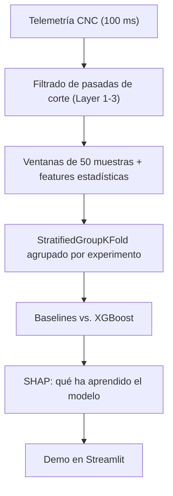

# Predicción de desgaste de herramienta en fresadora CNC

[](https://cnctoolwearapp.streamlit.app/)
[](https://github.com/itsguzman48/cnc-tool-wear-prediction/actions/workflows/ci.yml)
[](https://www.python.org/)
[](LICENSE)

> Clasificación de herramienta afilada (`unworn`) frente a desgastada (`worn`) a partir de la telemetría de servomotores y husillo de una fresadora CNC, con validación agrupada por experimento para evitar data leakage, interpretabilidad con SHAP y una demo en Streamlit.

<p align="center">
  
</p>

**Resultado principal, sin maquillaje:** con una evaluación honesta (ningún experimento aparece a la vez en train y test), ningún modelo supera a la línea base trivial. Este README explica por qué, qué demuestra eso y qué haría a continuación.

**Demo:** [cnctoolwearapp.streamlit.app](https://cnctoolwearapp.streamlit.app/), con experimentos de ejemplo precargados y subida de CSV de telemetría.

---

## 1. Problema y datos

En fresado, el desgaste del filo empeora el acabado y la precisión de la pieza y puede acabar en rotura de herramienta. La idea es detectarlo de forma no invasiva con las señales que la máquina ya registra.

Dataset: benchmark del **SMART Lab de la Universidad de Michigan**. Son **18 experimentos** de fresado sobre bloques de cera, con 48 señales registradas cada 100 ms (posición, velocidad, aceleración, corriente, tensión y potencia de los ejes X, Y, Z y del husillo S1). Cada experimento tiene una única etiqueta: `worn` o `unworn`.



---

## 2. Evaluación sin data leakage

El error típico en este dataset es hacer un `train_test_split` aleatorio por filas o por ventanas. Dos ventanas contiguas del mismo experimento son casi idénticas, así que el modelo "reconoce el experimento" en lugar de reconocer el desgaste, y las métricas salen infladas (por encima del 95%).

Lo que hago:

1. **Validación agrupada por experimento** (`StratifiedGroupKFold`, 5 folds, agrupando por `exp_id`). El test siempre son experimentos que el modelo no ha visto.
2. **Solo pasadas de corte activas** (`Layer 1 Up`, `Layer 1 Down`, …). Se descartan posicionamiento, preparación y movimientos en vacío.
3. **Features por ventana** de 50 muestras (5 s): media, desviación típica, máximo, mínimo, RMS, IQR y asimetría de las corrientes de X, Y, Z y S1.

---

## 3. Resultados

Validación cruzada agrupada por experimento (5 folds). Los valores son medias entre folds (± desviación típica cuando está calculada):

| Modelo | Accuracy | F1 (clase `worn`) | ROC-AUC |
| :--- | :---: | :---: | :---: |
| Dummy (clase mayoritaria) | 54,3% ± 3,9 | 0,703 ± 0,034 | 0,500 |
| Regresión logística | 43,7% ± 12,9 | 0,482 ± 0,206 | 0,365 |
| Random Forest (`max_depth=6`) | 42,9% ± 15,1 | 0,498 ± 0,213 | 0,375 |
| XGBoost (`max_depth=4`, regularizado) | 31,4% ± 17,8 | 0,390 ± 0,225 | 0,254 |

Fuente: [`reports/baseline_metrics.json`](reports/baseline_metrics.json) y [`reports/xgb_metrics.json`](reports/xgb_metrics.json).

### Cómo se lee esto

- **Ningún modelo generaliza a experimentos nuevos.** Todos quedan por debajo del Dummy, y los ROC-AUC están por debajo de 0,5.
- **Un AUC sistemáticamente menor que 0,5 no es azar.** Indica que lo que el modelo aprende en train se invierte en test. Mi hipótesis principal es que con solo 18 experimentos el modelo aprende **condiciones de cada experimento** en lugar de desgaste. `feedrate` y `clamp_pressure` entran como features y son constantes dentro de cada experimento, así que funcionan casi como un identificador. Con tan pocos grupos, cada fold deja fuera experimentos cuya combinación de condiciones y etiqueta no se parece a la de train.
- **Por eso el número interesante no es el accuracy, sino la diferencia entre evaluar mal y evaluar bien.** Con un split aleatorio este proyecto "tendría" más de un 95% de acierto. Con un split por experimento, el modelo no funciona. Detectar eso antes de llevar nada a planta es justo el objetivo de la validación agrupada.

> **Nota sobre `src/verificar.py`:** clasifica los 18 experimentos con el modelo final, que se ha entrenado con esos mismos 18. Es una comprobación **in-sample**: sirve para verificar que el pipeline funciona de punta a punta, no para medir el rendimiento. El rendimiento real es la tabla de arriba.

---

## 4. Interpretabilidad con SHAP


SHAP (`TreeExplainer`) muestra **en qué se apoya el modelo**. Las señales con más peso son la carga del husillo (`S1_OutputCurrent`, `S1_OutputPower`) y la corriente y aceleración del eje Z.

Esto encaja con la física esperada: con un filo desgastado aumenta la fuerza de corte, y con ella el consumo del husillo y el empuje axial. Pero **no es una validación**. SHAP explica al modelo, no a la máquina, y un modelo que no generaliza puede apoyarse en señales "físicamente razonables" por motivos espurios. Lo uso como herramienta de diagnóstico, no como conclusión.

---

## 5. Qué haría a continuación

Ordenado por lo que más información aporta:

1. **Quitar `feedrate` y `clamp_pressure`** de las features y comprobar si el AUC vuelve a ~0,5 o lo supera. Es la forma directa de confirmar o descartar la hipótesis del apartado 3.
2. **`LeaveOneGroupOut`** (18 folds de un experimento) en lugar de 5 folds. Con tan pocos grupos, 5 folds son muy inestables (fíjate en las desviaciones típicas).
3. **Normalizar cada experimento respecto a su propio arranque**, por ejemplo con el cociente frente a las primeras pasadas. Así se mide el cambio dentro del experimento y no el nivel absoluto, que depende de las condiciones de corte.
4. **Evaluar a nivel de experimento**, agregando las ventanas, que es la decisión que se tomaría en planta.
5. **Más datos.** Con 18 experimentos sobre cera, cualquier conclusión es limitada. Aplicarlo a metal o aleaciones aeronáuticas requeriría datos de ese material.

---

## 6. Estructura del repositorio

```text
cnc-tool-wear-prediction/
├── app/main.py                 # Demo en Streamlit (inferencia + SHAP por muestra)
├── data/
│   ├── sample/                 # 4 experimentos de ejemplo para la demo
│   └── raw/                    # Dataset completo (no versionado, ver apartado 7)
├── models/
│   ├── cnc_tool_wear_xgb.pkl   # Modelo XGBoost entrenado con los 18 experimentos
│   └── feature_columns.json    # Esquema de features esperado
├── notebooks/                  # 01 EDA · 02 features y baseline · 03 XGBoost y SHAP
├── reports/                    # Métricas en JSON y figuras
├── src/
│   ├── features.py             # Filtrado de fases, ventanas y features
│   ├── baseline.py             # Baselines con validación agrupada
│   ├── models.py               # XGBoost con validación agrupada + SHAP
│   ├── eda.py                  # Figuras de EDA
│   └── verificar.py            # Comprobación in-sample del pipeline completo
├── tests/test_features.py      # Tests de la ingeniería de features
└── .github/workflows/ci.yml    # CI: ruff + pytest en Python 3.10 y 3.13
```

---

## 7. Ejecución local

Requiere Python 3.10 o superior. El dataset completo no está en el repo: descárgalo de Kaggle ("CNC Mill Tool Wear", University of Michigan SMART Lab) y deja `train.csv` y los `experiment_XX.csv` en `data/raw/`.

```bash
git clone https://github.com/itsguzman48/cnc-tool-wear-prediction.git
cd cnc-tool-wear-prediction
python -m venv .venv
source .venv/bin/activate        # En Windows: .venv\Scripts\activate
pip install -r requirements.txt

python src/baseline.py           # Baselines con validación agrupada
python src/models.py             # XGBoost + SHAP
streamlit run app/main.py        # Demo
```

---

## 8. Autor

**Íñigo Guzmán** · [GitHub](https://github.com/itsguzman48) · [LinkedIn](https://www.linkedin.com/in/iniguzman)

Técnico Superior en ASIR, cursando la especialización en Inteligencia Artificial y Big Data.

Licencia [MIT](LICENSE).
