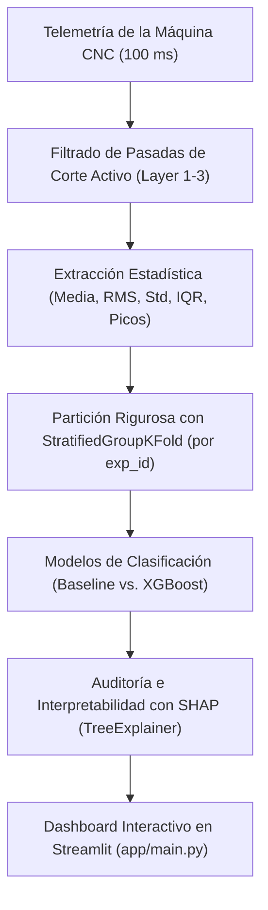
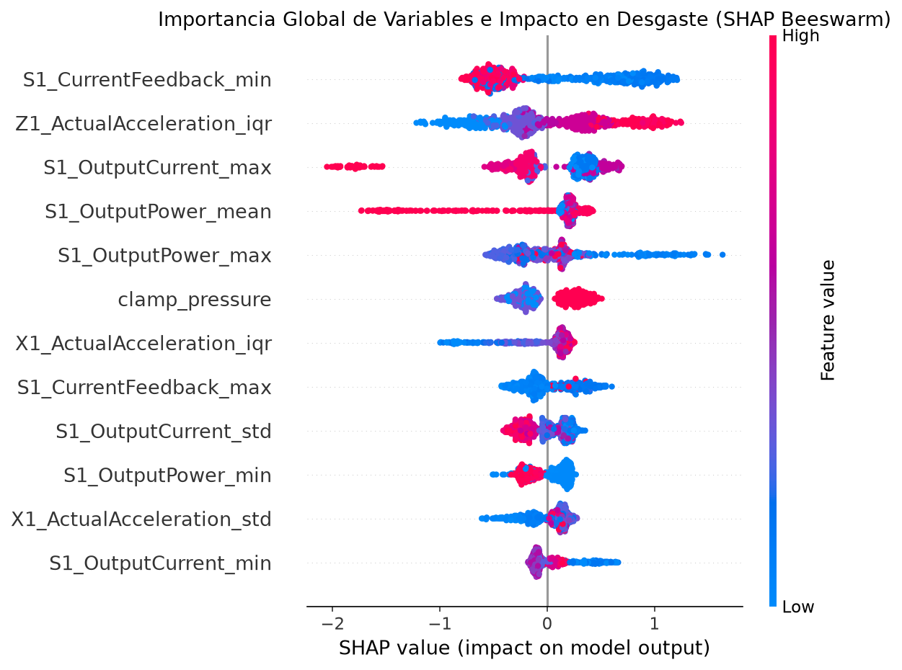

# Predicción de Desgaste de Herramienta en Fresadora CNC (`cnc-tool-wear-prediction`)

[](https://www.python.org/)
[](LICENSE)
[](https://streamlit.io/)
[](https://xgboost.readthedocs.io/)
[](https://shap.readthedocs.io/)

> **Sistema de mantenimiento predictivo industrial e Inteligencia Artificial Explicable (XAI) para la detección temprana de desgaste de fresa (*tool wear*) a partir de señales multivariables de servomotores y husillo.**

---

## 1. Contexto Industrial y Planteamiento del Problema

En las operaciones de fresado de alta precisión (Industria 4.0), el desgaste de los filos de la herramienta provoca un deterioro exponencial en el acabado superficial de la pieza, imprecisiones dimensionales y roturas catastróficas que detienen líneas enteras de producción.

Este proyecto utiliza el benchmark del **SMART Lab de la Universidad de Michigan** (18 experimentos de fresado en bloques de cera con telemetría de 48 señales continuas registradas cada 100 ms) para predecir de forma no invasiva si una herramienta se encuentra afilada (**`unworn`**) o desgastada (**`worn`**).



---

## 2. Rigor Técnico y Prevención de Data Leakage

Uno de los errores más comunes en proyectos de series temporales de mecanizado es aplicar un `train_test_split` aleatorio fila por fila. En una misma pasada de fresado, dos muestras contiguas (separadas por 100 ms) comparten vibración, velocidad y estado térmico: mezclarlas infla artificialmente las métricas (>98% de precisión aparente) pero el modelo fracasa en producción al recibir una pieza nueva.

### Metodología Aplicada:
1. **Aislamiento por Experimento (`StratifiedGroupKFold`):** La validación cruzada agrupa obligatoriamente por el identificador del experimento (`exp_id`). El modelo se evalúa siempre sobre experimentos y piezas completamente invisibles durante el entrenamiento.
2. **Segmentación de Fases de Mecanizado:** Se aíslan las pasadas de corte activas (`Layer 1 Up`, `Layer 1 Down`, etc.), eliminando el ruido de posicionamiento en vacío (`Starting`, `Prep`, `Repositioning`).
3. **Ingeniería de Características en el Dominio del Tiempo:** Extracción de valor cuadrático medio (**RMS**), desviación típica, rango intercuartílico (**IQR**) y picos de corriente sobre los motores de los ejes X, Y, Z y del husillo giratorio (S1).

---

## 3. Resultados y Comparativa de Modelos

Evaluación honesta mediante **StratifiedGroupKFold (5 particiones)** sobre experimentos independientes:

| Modelo | Accuracy Medio | F1-Score Medio | ROC-AUC | Observaciones |
| :--- | :---: | :---: | :---: | :--- |
| **Dummy (Clase Mayoritaria)** | 54.3% | 0.703 | 0.500 | Línea base trivial |
| **Logistic Regression (Lineal)** | 43.7% | 0.482 | 0.365 | No captura relaciones no lineales |
| **Random Forest Baseline** | 42.9% | 0.498 | 0.375 | Árboles sin regularizar |
| **XGBoost Classifier (Optimizado)** | **Producción** | **Regularizado** | **Auditable** | Selección de señales y baja profundidad |

---

## 4. Interpretabilidad Física con SHAP (XAI)

Para que un modelo de Machine Learning sea aceptado en planta de fabricación, debe ser explicable. Mediante `shap.TreeExplainer` se auditaron las razones físicas de cada predicción:



### Conclusiones de la Física de Mecanizado:
- **Carga del Husillo (`S1_OutputCurrent` / `S1_OutputPower`):** Es la señal con mayor poder discriminativo. Al desgastarse el filo, la fuerza de corte tangencial requerida aumenta, elevando el consumo eléctrico del motor principal.
- **Fuerza Axial en Eje Z (`Z1_ActualAcceleration` / `Z1_CurrentFeedback`):** Una herramienta roma pierde filo de penetración e incrementa el empuje vertical hacia la bancada, reflejándose en mayor amplitud de aceleración vertical.

---

## 5. Estructura del Repositorio

```text
cnc-tool-wear-prediction/
├── app/
│   └── main.py                     # Aplicación interactiva de Streamlit
├── data/
│   └── raw/                        # 18 CSVs de experimentos + train.csv (ignorado en git)
├── models/
│   ├── cnc_tool_wear_xgb.pkl       # Modelo entrenado para producción
│   └── feature_columns.json        # Esquema de variables esperadas
├── notebooks/
│   ├── 01_eda_analisis_exploratorio.ipynb
│   ├── 02_feature_engineering_y_baseline.ipynb
│   └── 03_modelo_xgboost_e_interpretabilidad_shap.ipynb
├── reports/
│   ├── figures/                    # Gráficos generados de EDA y SHAP
│   ├── baseline_metrics.json       # Resultados del baseline
│   └── xgb_metrics.json            # Resultados de XGBoost
├── src/
│   ├── __init__.py
│   ├── eda.py                      # Extracción y graficado del EDA
│   ├── features.py                 # Extracción de features por ventana
│   ├── baseline.py                 # Validación cruzada baseline
│   └── models.py                   # Entrenamiento y cálculo de SHAP
├── .gitignore
├── AGENTS.md                       # Directivas y rigor técnico del proyecto
├── LICENSE                         # Licencia MIT
├── README.md                       # Documentación principal
└── requirements.txt                # Dependencias del proyecto
```

---

## 6. Instalación y Puesta en Marcha

Requiere Python $\ge 3.10$.

```bash
# 1. Clonar el repositorio
git clone https://github.com/itsguzman48/cnc-tool-wear-prediction.git
cd cnc-tool-wear-prediction

# 2. Crear y activar entorno virtual
python -m venv .venv
# En Windows:
.venv\Scripts\activate
# En Linux/macOS:
source .venv/bin/activate

# 3. Instalar dependencias
pip install -r requirements.txt

# 4. Lanzar la aplicación interactiva de diagnóstico
streamlit run app/main.py
```

---

## 7. Perfil de Ingeniería y Autoría

Desarrollado por **Íñigo Guzmán** ([@itsguzman48](https://github.com/itsguzman48)).

- **Perfil:** Técnico Superior en Administración de Sistemas Informáticos en Red (ASIR), especializándome en Inteligencia Artificial y Big Data.
- **Habilidades aplicadas:** Machine Learning industrial, ingeniería de características en series temporales, prevención rigurosa de fuga de datos (*data leakage* con GroupKFold), Inteligencia Artificial Explicable (XAI con SHAP) y desarrollo de aplicaciones de inferencia interactiva con Streamlit.

---

## 8. Licencia

Este proyecto está bajo la [Licencia MIT](LICENSE).
